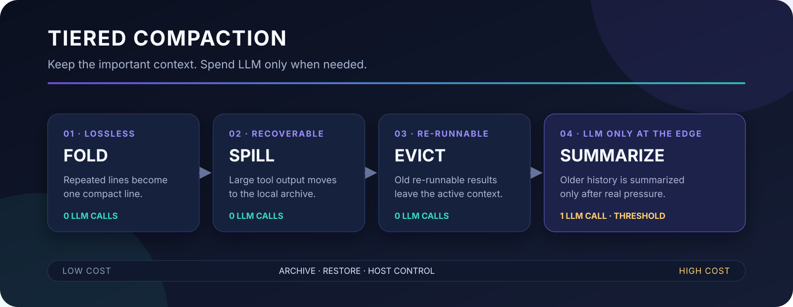
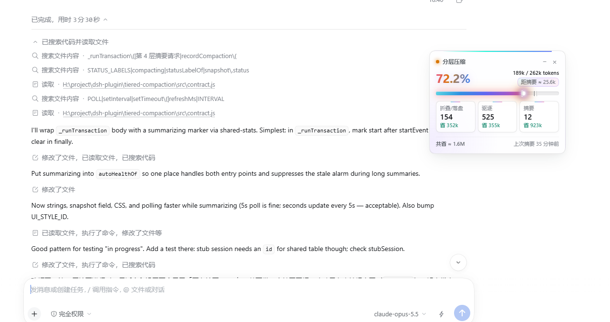

<div align="center">

# tiered-compaction

**Organize context first. Spend an LLM call only when it is truly needed.**

A tiered context compaction plugin for DSH: fold → spill → evict → summarize. The first three tiers make no LLM calls; summarization starts only when pressure reaches the threshold.

[](https://github.com/topics/dsh-plugin)
[](https://github.com/2849236173/tiered-compaction/releases)
[](LICENSE)
[](package.json)

[简体中文](README.md) · [English](README.en.md)



</div>

> Current stable release: **0.4.1**. Stable is recommended for daily use. Beta may include new fixes or features but is **not fully tested**.

## See it in 30 seconds

A one-shot compaction waits until pressure is high and then processes history at once. `tiered-compaction` orders work from low cost to high cost: lossless cleanup first, recoverable space reclamation next, and an LLM call only at the edge.

| Tier | What happens | LLM cost | Recovery |
|---|---|---:|---|
| **1 · Fold** | Three or more consecutive repeated lines collapse into one | 0 calls | Lossless |
| **2 · Spill** | Tool output over 8 KB moves to disk; the active context keeps a preview and path | 0 calls | Read the archive |
| **3 · Evict** | A reminder at 70% pressure; old re-runnable tool results leave at 80% | 0 calls | Re-run the command |
| **4 · Summarize** | Older history is summarized when pressure reaches the threshold (about 82%) | 1 call | Original history is archived |

### Why not just summarize once?

| | One-shot compaction | `tiered-compaction` |
|---|---|---|
| Trigger | Wait until pressure is high | Progress through low-cost tiers first |
| First three tiers | Often goes straight to a model | No LLM calls |
| Tool output | Competes with conversation history for space | Large output spills first, with a preview and path retained |
| Recovery | Depends on summary accuracy | Read the archive or re-run the original command |
| Host integration | Uses the default strategy | Integrates through a DSH Bundle Patch |

## What it looks like in DSH

The HUD puts context pressure, actual token use, the count of three processing classes, and the distance to the next summary beside the conversation. The settings page shows the same information with more detailed per-tier statistics.

<div align="center">

</div>

- The large percentage is the share of the context window in use; the top right shows actual token usage and the distance to the next summary.
- Three cards count fold/spill, eviction, and summary runs, including tokens saved.
- While a summary runs, the HUD shows “Summarizing… Ns”.
- When a session is idle, compaction waits for the next message and the HUD says so.

## Install

The plugin ships in two release tracks. Pick one:

| Track | For | npm tag |
|---|---|---|
| **Stable** | Most users who want a tested default | `latest` |
| **Beta** | Users willing to try new fixes/features and report issues | `beta` |

**Install stable:**

```powershell
dsh plugin --profile desktop add dsh-tiered-compaction@latest
```

**Install beta:**

```powershell
dsh plugin --profile desktop add dsh-tiered-compaction@beta
```

The command may end with `ERR_PNPM_IGNORED_BUILDS`. pnpm skipped an install script that only prints a message; the plugin itself is installed and you can ignore it.

Fully quit and reopen DSH after installation. No manual configuration is needed. For the web app, CLI, or TUI, replace `desktop` with `web`, `headless`, or `tui`.

> Beta is not always newer than stable. After a stable release, the beta tag may still point to an older version. Check both tags before installing:
>
> ```powershell
> npm view dsh-tiered-compaction dist-tags
> ```

## Enable all four tiers

Each DSH session binds to a preset when it is created and keeps that preset. With only the plugin installed, every session gets tiers 1 and 2, while tiers 3 and 4 stay with the official compaction. To enable all four tiers, switch the preset to this plugin's version:

| Preset | How |
|---|---|
| `cordis` (desktop default) | Install the `tiered-cordis-preset` bundle |
| `ptc-tc` | `tools/generators/gen-ptc-tc.ps1 -Apply` |
| `standard` (used by Bots and group chats) | `tools/generators/gen-standard-tc.ps1 -Apply` |
| Official `ptc`, `minimal` | `tools/generators/gen-standard-tc.ps1 -Preset ptc -Apply`, and the same for `minimal` |

Only **new sessions** pick up the change; existing sessions keep their preset. Re-run the generators after upgrading DSH.

## Check that it works

Search the host log for `tiered-compaction 健康`:

```text
tiered-compaction 健康 window=262144 pressure=57.3% ... status=ok
```

`status=ok` means healthy. `status=warn` is followed by what went wrong.

## Update, switch, uninstall

Updating and switching tracks both use `add` with a tag. Run it again:

| Goal | Command |
|---|---|
| Stable → newest stable | `dsh plugin --profile desktop add dsh-tiered-compaction@latest` |
| Beta → newest beta | `dsh plugin --profile desktop add dsh-tiered-compaction@beta` |
| Stable → beta | `dsh plugin --profile desktop add dsh-tiered-compaction@beta` |
| Beta → stable | `dsh plugin --profile desktop add dsh-tiered-compaction@latest` |
| Uninstall and restore official compaction | `dsh plugin --profile desktop remove dsh-tiered-compaction` |

Do not use `update`: installation records an exact version, and `update` neither moves past it nor switches tracks.

Fully quit and reopen DSH afterwards. To see the installed version:

```powershell
dsh plugin --profile desktop list dsh-tiered-compaction
```

## Configuration

All fields are optional; omitted fields use their defaults:

| Field | Default | Meaning |
|---|---|---|
| `enabled` | `true` | Take over compaction |
| `auto` | `true` | Compact automatically; with `false`, only manual `/compact` |
| `archiveDir` | `~/.dsh/tiered-archive` | Archive directory |
| `summaryTarget` | Session's model | `provider` and `model` used for summaries |
| `modelPolicies` | none | Per-model threshold and retry overrides |
| `scopeId` | unset | Used when mounted in a preset; generators fill it in |

## Known limits

- Tool results containing images or attachments are left alone.
- Spill previews are fixed at 5120 characters; the full text is in the archive.
- The current implementation targets the DSH 0.2.x compaction interface; recheck after a major DSH upgrade.

## More

- [Architecture and design](docs/architecture.md)
- Tier details: [1](docs/tier1-lossless-folding.md) · [2](docs/tier2-spill-to-disk.md) · [3](docs/tier3-soft-pressure.md) · [4](docs/tier4-lossy-summarization.md)
- [Changelog](CHANGELOG.en.md)

## License

MIT
