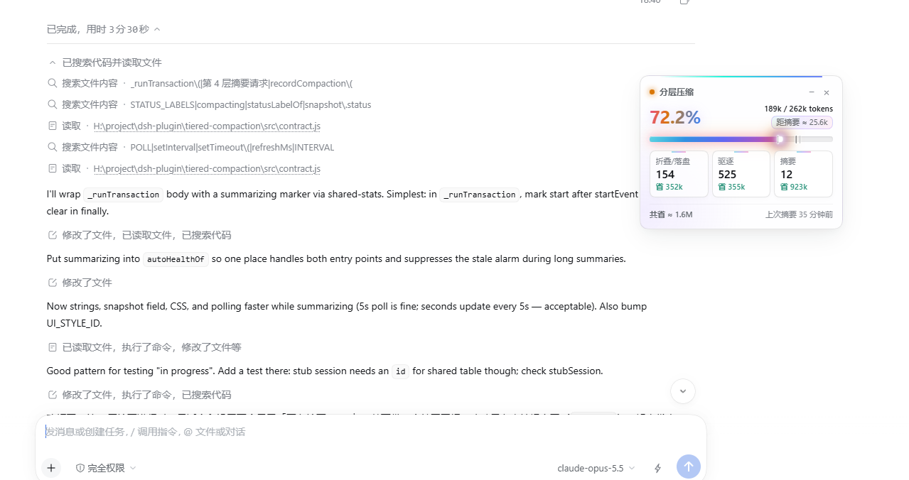

**简体中文** | [English](README.en.md)

# tiered-compaction

DSH 的分层上下文压缩插件。前三层不调用 LLM，只有压力真正到阈值时才做一次摘要。



当前正式版：**0.4.1**

## 它做什么

| 层 | 做法 | 成本 |
|---|---|---|
| 1 · 折叠 | 连续重复 3 次以上的行折叠成一行 | 不调用 LLM |
| 2 · 落盘 | 超过 8 KB 的工具输出存到磁盘，上下文只留预览和路径 | 不调用 LLM |
| 3 · 驱逐 | 压力到 70% 提醒收束；到 80% 移除旧的可重跑工具结果 | 不调用 LLM |
| 4 · 摘要 | 压力到阈值（约 82%）时调用 LLM 摘要较早的历史 | 1 次 LLM |

被处理过的内容都能找回：落盘和摘要前的原文保存在 `~/.dsh/tiered-archive`，可以用 `tiered_restore` 工具读回；被驱逐的工具结果重跑原命令即可恢复。

## 安装

```powershell
dsh plugin --profile desktop add dsh-tiered-compaction
```

装完重启 DSH 即可，不用改配置。Web 版、命令行、TUI 把 `desktop` 换成 `web`、`headless`、`tui`。

## 让四层全部生效

DSH 的每个会话在创建时绑定一个预设，之后不能更换。只装插件时，所有会话都有第 1、2 层，第 3、4 层还是官方压缩。要四层全开，需要把预设换成本插件的版本：

| 预设 | 怎么开启 |
|---|---|
| `cordis`（桌面端默认） | 安装 `tiered-cordis-preset` bundle |
| `ptc-tc` | `tools/gen-ptc-tc.ps1 -Apply` |
| `standard`（Bot 和群聊使用） | `tools/gen-standard-tc.ps1 -Apply` |
| 官方 `ptc`、`minimal` | `tools/gen-standard-tc.ps1 -Preset ptc -Apply`，`minimal` 同理 |

改完之后**新开的会话**才生效，已有会话保持原样。DSH 升级后要重跑一次生成器。

## 悬浮窗

- 大号百分比是当前上下文占窗口的比例，右上角是实际 token 用量和距下次摘要还差多少。
- 三张卡片分别是折叠/落盘、驱逐、摘要的次数和省下的 token。
- 摘要进行中会显示「正在摘要… Ns」。
- 会话空闲时，压缩要等你发下一条消息才会触发，悬浮窗会提示「下条消息时自动压缩」。

设置页里有同样的信息和更详细的分层统计。

## 更新和卸载

```powershell
dsh plugin --profile desktop update dsh-tiered-compaction   # 升到最新正式版
dsh plugin --profile desktop add dsh-tiered-compaction@beta # 装尝新版
dsh plugin --profile desktop remove dsh-tiered-compaction   # 卸载，官方压缩自动恢复
```

更新后要完全退出 DSH 再打开。

## 配置

全部可选，不填就用默认值。

| 字段 | 默认 | 说明 |
|---|---|---|
| `enabled` | `true` | 是否接管压缩 |
| `auto` | `true` | 是否自动压缩；`false` 时只能手动 `/compact` |
| `archiveDir` | `~/.dsh/tiered-archive` | 存档目录 |
| `summaryTarget` | 跟随会话 | 摘要用的 `provider` 和 `model` |
| `modelPolicies` | 无 | 按模型覆盖阈值和重试次数 |
| `scopeId` | 不填 | 预设里挂载时用，生成器会自动填 |

## 确认它在工作

在宿主日志里搜 `tiered-compaction 健康`：

```
tiered-compaction 健康 window=262144 pressure=57.3% ... status=ok
```

`status=ok` 表示正常，`status=warn` 后面会写明发现了什么问题。

## 已知限制

- 含图片或附件的工具结果不处理。
- 落盘预览固定 5120 字符，完整原文在存档里。
- 按 DSH 0.2.x 的压缩接口实现，DSH 大版本升级后需要重新核对。

## 更多文档

- [架构与设计理念](docs/架构与设计理念.md)，[架构图](docs/架构图.html)
- 各层细节：[第 1 层](docs/第1层-无损折叠.md)、[第 2 层](docs/第2层-落盘.md)、[第 3 层](docs/第3层-软压力.md)、[第 4 层](docs/第4层-有损摘要.md)
- [更新记录](CHANGELOG.md)

## License

MIT
